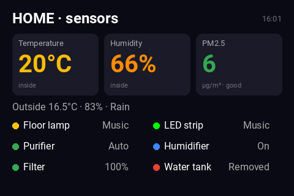
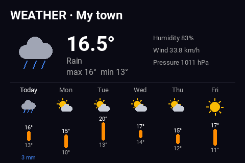

# turing-dashboard

A "now playing" + homelab-stats dashboard for a [Turing Smart Screen](https://github.com/mathoudebine/turing-smart-screen-python) (the small USB serial LCD sold under various names — 3.5"/5", Turing/XuanFang/etc.), running on a Raspberry Pi (or any Linux box).

Priority order, checked every ~2 seconds:

1. **Sonos** — if any speaker on the LAN is playing, shows its album art, track/artist/album, room (+ group, if speakers are grouped), volume, and "up next". With Home Assistant configured, the now-playing screen alternates with the house sensors and weather screens (16 s music, 8 s each of the others).
2. **Jellyfin** — if nothing's playing on Sonos but a movie/episode is actively playing on a Jellyfin server, shows poster art, title, and progress.
3. **Idle** — cycles every 8s between Proxmox host stats (CPU/RAM/disk/uptime), a bandwidth graph (via Prometheus + node_exporter) and, if Home Assistant is configured, the house sensors and the weather with the week's forecast.

| House sensors | Weather |
|---|---|
|  |  |

## Hardware / prerequisites

- A Turing Smart Screen (this was built and tested against Revision A hardware — a 3.5" model with USB vendor "Turing").
- This script depends on the display driver library from [mathoudebine/turing-smart-screen-python](https://github.com/mathoudebine/turing-smart-screen-python) — clone that repo first, then drop the files from this repo into it:

  ```bash
  git clone https://github.com/mathoudebine/turing-smart-screen-python.git
  cd turing-smart-screen-python
  python3 -m venv venv
  ./venv/bin/pip install -r requirements.txt   # the upstream repo's own requirements
  # then copy this repo's files in:
  cp /path/to/turing-dashboard/*.py .
  cp /path/to/turing-dashboard/sonos_dashboard_config.example.json ./sonos_dashboard_config.json
  ./venv/bin/pip install -r /path/to/turing-dashboard/requirements.txt
  ```

## What each source needs

- **Sonos**: nothing to configure — it auto-discovers every speaker on the LAN (`soco.discover()`) at startup and every 60s, and just displays whichever one is actually playing.
- **Jellyfin**: an API key (Jellyfin admin dashboard → API Keys) and the server's host/port.
- **Proxmox**: a read-only API token (Datacenter → Permissions → API Tokens) and the node name.
- **Prometheus**: only needs a URL — assumes `node_exporter` metrics are already being scraped for the host you want a bandwidth graph for. You'll need to fill in the exact `instance` and `device` labels for that host's physical NIC (check `curl http://<prometheus>:9090/api/v1/query?query=node_network_receive_bytes_total` to find them — don't guess, there are usually multiple scrape targets and virtual interfaces in the same Prometheus that would double-count or show the wrong thing).
- **Home Assistant** (optional): adds the two screens above (`home_screens.py`). Create a long-lived access token (your profile → Security → Long-lived access tokens) and fill in the `homeassistant` block:
  - `url`, `token` — your Home Assistant address and the token.
  - `weather` — a weather entity with a daily forecast (the default Met.no one is `weather.forecast_home`); `location` is just the title.
  - `sensors` — up to 4 big tiles as `[label, entity_id, kind]`, where kind is `temp`, `humidity` (orange outside 40–60 %), `pm25` (green/yellow/orange/red by air quality) or `climate` (room and target temperature of a thermostat).
  - `devices` — up to 6 status rows as `[label, entity_id]`: lights (dot in the light's colour, effect name if one runs), fans and purifiers (preset mode), humidifiers, and any sensor (filter levels show green/red, "removed"/"empty" states red).
  - Entities that don't exist or are unavailable are simply skipped. Sensors are read every 30 s, the forecast every 15 min. Leave the whole block out and the dashboard behaves as before.
- **Spotify** (optional, only used as a fallback): Sonos's own API can tell you what's queued up next *only* for classic Sonos-queue playback (an album/playlist browsed from the Sonos app). If you listen via **Spotify Connect through Sonos** (the common case), Sonos's queue is empty — Spotify's servers control it, not Sonos — so this script falls back to Spotify's own Web API for "up next" in that case. To enable it:
  1. Create an app at [developer.spotify.com/dashboard](https://developer.spotify.com/dashboard), enable the Web API, and add `http://127.0.0.1:8888/` as a Redirect URI (must match **exactly** what you put in the config — Spotify rejects any mismatch, including a missing/extra trailing slash or path).
  2. Fill in `client_id`/`client_secret`/`redirect_uri` in the config.
  3. Run `python spotify_auth_setup.py` — it prints an authorize URL. Open it, log in, approve, and you'll land on a `127.0.0.1:8888` page that won't load (expected — nothing's listening there). Copy the full URL from your browser's address bar.
  4. Run `python spotify_auth_setup.py '<paste the URL here>'` — this exchanges the code for a token, cached to `.spotify-cache`. From then on it refreshes automatically, no browser step needed again.
  - If you don't set this up, "up next" just won't show during Spotify Connect playback — everything else works fine without it.

Copy `sonos_dashboard_config.example.json` to `sonos_dashboard_config.json` and fill in your own values. This file has real credentials in it — it's gitignored, keep it that way.

## Running

```bash
./venv/bin/python sonos_dashboard.py
```

To run it persistently, copy `sonos-dashboard.service` to `/etc/systemd/system/`, fill in your username and paths, then:

```bash
sudo systemctl daemon-reload
sudo systemctl enable --now sonos-dashboard.service
```

## Known limitations

- The screens use the Roboto font from the upstream repo, which has no emoji or arrow glyphs, so weather icons are drawn rather than typed.

- Sonos "up next" (without the Spotify fallback) doesn't account for shuffle order, and doesn't apply to radio/non-queue streams.
- Sonos device discovery can be inconsistent run-to-run on some networks — the code re-discovers every 60s to self-heal, but a room might briefly not appear.
- SoCo's own default per-call timeout is 20 seconds; with several speakers to poll every loop, a couple of sleeping/offline ones can otherwise stall the whole dashboard for well over a minute. This is set to 3 seconds (`soco.config.REQUEST_TIMEOUT`) — lower it further if you have many speakers and want faster cycling, or raise it if you're seeing spurious "unreachable" gaps on a slow network.
